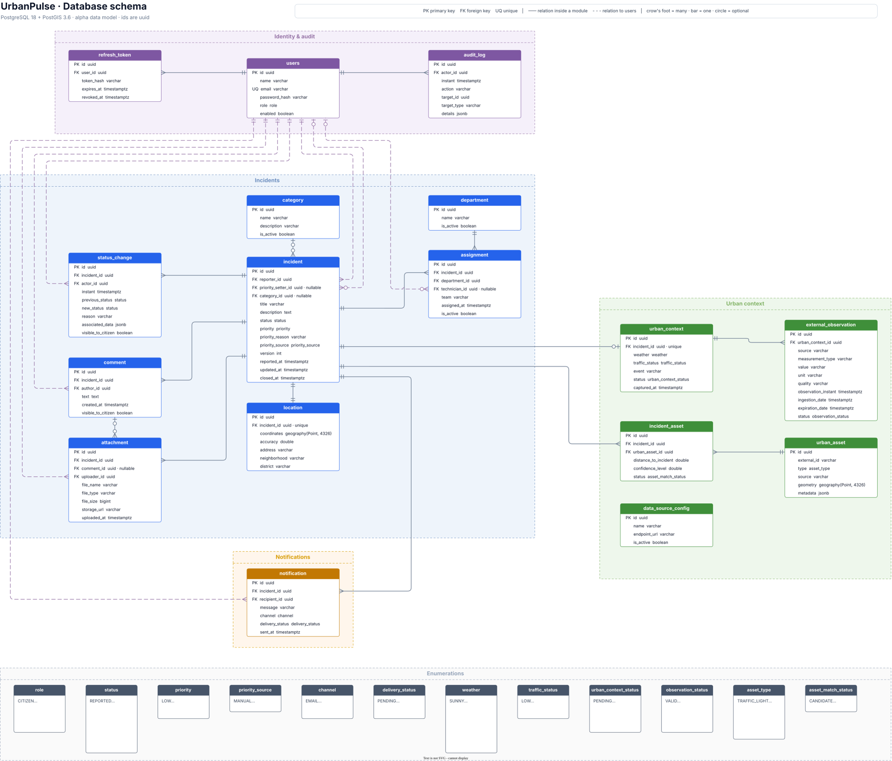

# 🏙️ UrbanPulse

UrbanPulse is a platform for managing urban incidents reported by citizens and enriching them with contextual data from the city of Malaga.

> **Status:** Early development. The repository currently contains the Spring Boot backend skeleton, its local PostgreSQL/PostGIS infrastructure, the versioned database schema, the API contract and the skeleton of the web and mobile clients. Incident management workflows are not implemented yet.

## 🎯 Purpose

UrbanPulse aims to support the registration, classification, prioritization, tracking, analysis, and resolution of urban incidents.

The platform assists municipal staff. It does not replace human decisions for sensitive actions.

## 📦 Current Scope

The repository currently provides:

- A Spring Boot backend built with Java 25.
- PostgreSQL with PostGIS for relational and geospatial data.
- Spring Data JPA and PostgreSQL connectivity.
- The database schema of the whole data model, created by versioned Flyway migrations.
- Docker Compose integration for local database startup, and a container image of the backend.
- The OpenAPI 3.1 contract (`docs/api/openapi.yml`), served by the backend with Swagger UI.
- Spring Security with only the Actuator health endpoints and the API documentation open.
- Integration tests against PostGIS with Testcontainers.
- A GitHub Actions pipeline (format, tests, coverage, static analysis and smoke test) and a pre-commit hook that formats staged Java and client files.
- Maven Wrapper.
- A pnpm workspace in `frontend/` with the web app (React + Vite), the mobile app (React Native + Expo) and their shared packages, including the API client generated from the OpenAPI contract.

## 🧰 Technology Stack

- Java 25
- Spring Boot 4.1.1
- Spring Data JPA
- Spring Security
- PostgreSQL 18 with PostGIS 3.6
- Flyway
- Docker Compose
- Testcontainers
- GitHub Actions
- Maven Wrapper
- TypeScript, React and Vite (web)
- React Native and Expo (mobile)
- Node.js 24 and pnpm workspaces

## 🐛 Prerequisites

Install Java 25, Docker Engine or Docker Desktop, and Git. Maven and PostgreSQL do not need to be installed locally. To work on the web or mobile clients, also install Node.js 24; pnpm is provided by Corepack (see the [development guide](docs/development.md)).

When running the project from a terminal, make sure Java 25 is available in `PATH` and `JAVA_HOME` points to the Java 25 JDK.

## ⚡ Quick Start

Clone the repository and enter the backend directory:

```bash
git clone https://github.com/Dalibex/urban-incidence-manager.git
cd urban-incidence-manager/backend
```

### ⚙️ Create the local environment file

Linux or macOS:

```bash
cp .env.example .env
```

Windows PowerShell:

```powershell
Copy-Item .env.example .env
```

Replace `POSTGRES_PASSWORD` in `.env`, then start the backend.

### 🍂 Run the application

Linux or macOS:

```bash
./mvnw spring-boot:run
```

Windows PowerShell:

```powershell
./mvnw.cmd spring-boot:run
```

Spring Boot detects `docker-compose.yaml`, starts PostgreSQL/PostGIS, waits until the database is healthy, and configures the connection.

To run the backend as a container instead, with the same image as the CI, use `docker compose --profile app up --build` (see the [development guide](docs/development.md)).

## 🚀 Testing

Docker must be running: the integration tests start their own PostGIS container with Testcontainers.

Linux or macOS:

```bash
./mvnw verify
```

Windows PowerShell:

```powershell
./mvnw.cmd verify
```

## 🗂️ Project Structure

```text
urban-incidence-manager/
|-- .githooks/
|-- .github/
|-- backend/
|   |-- Dockerfile
|   |-- docker-compose.yaml
|   |-- pom.xml
|   |-- mvnw
|   |-- mvnw.cmd
|   `-- src/
|-- docs/
|   |-- adr/
|   |-- api/
|   |-- ci-setup.md
|   |-- ci.md
|   `-- development.md
|-- frontend/
|   |-- apps/
|   |   |-- web/
|   |   `-- mobile/
|   |-- packages/
|   |   |-- api-client/
|   |   |-- domain/
|   |   `-- ui/
|   |-- package.json
|   `-- pnpm-workspace.yaml
|-- AGENTS.md
|-- CHANGELOG.md
`-- README.md
```

## 🗄️ Database Schema

Data model created by the Flyway migrations. Click the image to open it at full size.

[](docs/database.drawio.svg)

The diagram is a `.drawio.svg`: GitHub shows it as an image, and draw.io opens it as an editable diagram. The Flyway migrations in `backend/src/main/resources/db/migration` ([ADR-0014](docs/adr/0014-database-migrations-flyway.md)) are the source of truth for the schema; if the diagram and the migrations disagree, the migrations are right. Update this diagram in the same pull request that changes the schema.

## 📚 Documentation

- [Development guide](docs/development.md)
- Deployment guide **TBC**
- [API guide](docs/api.md) and [OpenAPI contract](docs/api/openapi.yml)
- [C4 architecture model](docs/architecture/)
- [Database schema](docs/database.drawio.svg)
- [CI guide](docs/ci.md) and [CI setup](docs/ci-setup.md)
- [Architecture Decision Records](docs/adr/)
- [Changelog](CHANGELOG.md)
- [Contributing guide](CONTRIBUTING.md)
- [Security policy](SECURITY.md)
- [AI Agents Context](AGENTS.md)

Architecture documents distinguish accepted decisions from proposals. Check each ADR status before treating it as implemented.

## 📄 License

This project is licensed under the [Apache License 2.0](LICENSE).
