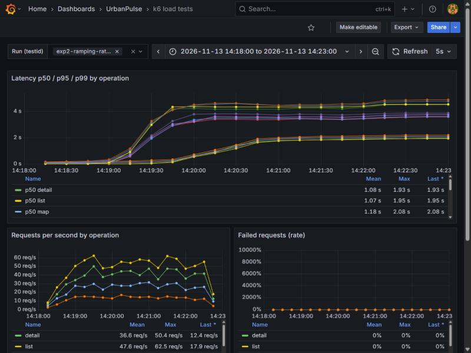
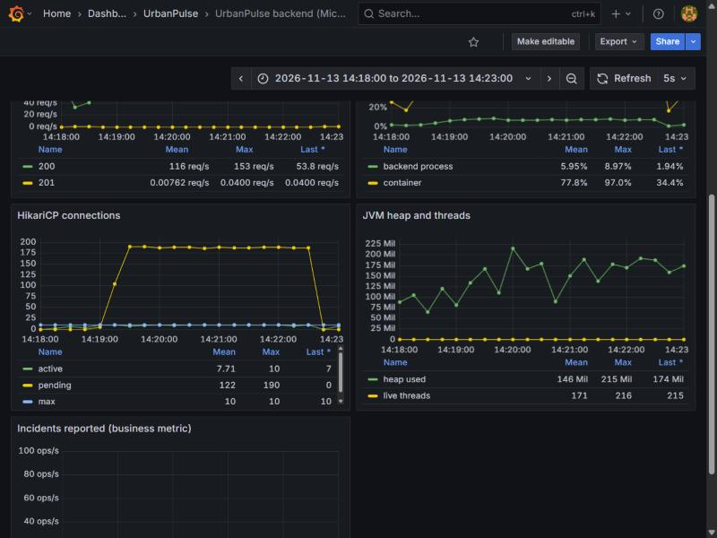

# Results of the quality-attribute and observability practice

How the experiments run is in [README.md](README.md). Every table cell is the **mean of three runs,
with the lowest and the highest in brackets**. Each run writes its k6 summary to `results/`, which
Git ignores; `python tables.py` rebuilds these tables from them after a new set of runs.

## Conditions

| | |
| --- | --- |
| Code | `main` at `b618646` (#262 merged), plus this branch: Micrometer and the `observability` profile |
| Machine | Laptop, AMD Ryzen 5 4600H (6 cores, 12 threads), 15 GB RAM, Windows 11, on mains power |
| Containers | Docker Desktop 29.8.2 (12 CPUs and 8 GB for its VM): `postgis/postgis:18-3.6`, the backend image of this branch, Prometheus and Grafana |
| Load generator | k6 v1.0.0-rc1 on the same laptop, against `http://localhost:8090/api/v1` (the backend directly, not through nginx) |
| Data | `perf` profile: 100,000 incidents for experiments 1 to 3; 1,000 to 1,000,000 for experiment 4 |
| Method | Before every repetition that creates incidents the database is reset to the same `perf` rows. Every measurement follows 30 s of unmeasured warm-up. Each configuration runs three times. Sign-in happens once in `setup()` |
| Quality target | QA-1 of `docs/architecture.md`: p95 under 500 ms and no errors |

Backend, database and load generator share one machine, so a high load also takes CPU from k6:
the figures are relative to this laptop, not to the demo machine.

## Experiment 1: which operations are slowest?

Each operation alone, 10 VUs without think time, 60 s each (the practice suggests 2 minutes; 60 s
keeps the three repetitions of the eight operations within 35 minutes).

| Operation | p50 (ms) | p95 (ms) | p99 (ms) | Requests/s | Errors (%) |
| --- | --- | --- | --- | --- | --- |
| report (`GET /incident-reports`, a year by category) | 267.1 (257.0–285.9) | 309.4 (290.5–334.1) | 356.0 (317.6–388.3) | 37 (34–39) | 0 |
| statistics (`GET /incident-statistics`) | 228.6 (214.7–249.8) | 304.6 (276.1–344.6) | 350.3 (316.4–397.9) | 42 (38–45) | 0 |
| map (`GET /incident-locations`) | 160.3 (152.4–175.7) | 230.7 (203.5–280.5) | 291.1 (236.8–394.9) | 60 (53–64) | 0 |
| list (`GET /incidents`, first page) | 25.3 (22.4–26.9) | 48.8 (34.7–62.3) | 66.0 (45.2–85.0) | 348 (301–410) | 0 |
| list-filtered (status and priority) | 19.3 (17.7–20.7) | 29.2 (24.2–36.2) | 38.9 (31.0–51.1) | 484 (435–532) | 0 |
| create (`POST /incidents`) | 10.9 (10.2–11.5) | 21.1 (14.3–28.3) | 31.3 (20.3–38.8) | 782 (675–910) | 0 |
| detail (`GET /incidents/{id}`) | 7.1 (6.4–8.1) | 11.4 (9.4–14.2) | 15.8 (12.8–19.9) | 1275 (1095–1427) | 0 |
| history (`GET /incidents/{id}/status-changes`) | 6.3 (6.1–6.7) | 10.0 (9.4–11.2) | 14.5 (13.0–17.0) | 1416 (1322–1471) | 0 |

1. **Highest latency:** the report, then the statistics and the map. The three read every incident
   that matches (the whole year, or every open incident) and aggregate them; the others read one
   page or one incident through an index.
2. **Slowest and least throughput:** yes. With the same 10 VUs, the report gives 37 requests per
   second and the history 1,416: with a closed loop of users, throughput is the inverse of latency.
3. **p50 against p99:** the gap is small, from 1.3 to 2.6 times. No operation has a long tail at
   this load; the variation between runs is larger than the tail.
4. **Priority for optimisation:** the map. It is not the slowest, but the web refreshes it on its
   own every few seconds for every staff user, and the dashboard (statistics) goes with it, so
   together they set the load of the database (experiments 2 and 3). The report is the slowest but
   is asked for rarely, by analysts.

All meet QA-1 at this load.

## Experiment 2: what is the capacity of the system?

The staff browsing mix: 40 % inbox, 30 % detail, 20 % map and 10 % dashboard, one request per
iteration.

| Configuration | p50 (ms) | p95 (ms) | p99 (ms) | Requests/s | Errors (%) | Dropped iterations |
| --- | --- | --- | --- | --- | --- | --- |
| ramping-vus 10→25→50→100, 1 s of think time | 18.1 (17.4–18.9) | 158.9 (156.1–161.7) | 209.0 (202.3–220.5) | 42 (42–42) | 0 | 0 |
| ramping-arrival-rate 20→600 per second | 2001.4 (1944.0–2075.9) | 3650.6 (3599.7–3677.0) | 4663.2 (4546.0–4803.5) | 126 (123–128) | 0 | 56315 (55673–57005) |
| constant-arrival-rate 100 per second, 2 min | 23.8 (22.2–26.2) | 246.9 (206.1–292.6) | 420.5 (293.7–614.6) | 100 (100–100) | 0 | 5 (0–14) |
| constant-arrival-rate 150 per second, 2 min | 786.9 (121.8–1944.5) | 2223.7 (416.1–3552.2) | 3039.0 (637.0–4420.2) | 142 (136–149) | 0 | 772 (45–1413) |

The steps of the `ramping-vus` run, read from Prometheus (mean of the 5-second p95 windows of the
three runs):

| VUs | Requests/s | p95 (ms) | p99 (ms) |
| --- | --- | --- | --- |
| 10 | 8 | 67 | 71 |
| 25 | 19 | 70 | 78 |
| 50 | 38 | 82 | 96 |
| 100 | 86 | 108 | 146 |

With think time, 100 users ask for 86 requests per second and the API stays far from its limits.
The arrival-rate runs show the limit, in requests per second instead of users:

- Up to about **120 requests per second** the p95 stays around 300 ms.
- Between 125 and 140 requests per second the system **saturates**: in under a minute the p95 jumps
  to 3.5–4 s, the 300 VUs that k6 may use are all waiting, and the throughput stops growing at
  about 140 requests per second however much load is offered.
- `constant-arrival-rate` confirms it: 100 per second meets QA-1 (p95 247 ms, 5 dropped
  iterations in three runs); 150 per second does not (p95 2.2 s, 772 dropped iterations, 142 served).
- **There are no errors at any point**: the API does not fail, it queues. The requests wait for a
  database connection.

**Concurrency, capacity and scalability.** Concurrency is how many requests are in progress at once
(the VUs waiting). Capacity is the rate the system serves within its target: about 120 requests per
second of this mix on this laptop. Past it, more concurrency only adds waiting time, because the
throughput is fixed at about 140 per second. Scalability would be how that capacity changes with
more resources, which experiment 4 starts to answer with the schema instead of instances.

**Where the bottleneck is (k6 and Micrometer together).** During the saturation of the first
`ramping-arrival-rate` run:

| Metric | Before the load | Saturated |
| --- | --- | --- |
| p95 (k6) | 170 ms | 3.8 s |
| Errors (k6) | 0 % | 0 % |
| HikariCP active connections | 0 of 10 | 10 of 10 |
| HikariCP pending connections | 0 | about 190 |
| CPU of the backend process | 1 % | 8 % |
| CPU of the Docker machine | 10 % | 96 % |

The backend is almost idle while every database connection is busy and almost 190 requests wait
for one; the CPU goes to PostgreSQL, running the aggregates of the map and the dashboard. The
bottleneck is the database, not Spring Boot: another backend instance would only add requests to
the same queue.

**`dropped_iterations`.** With an arrival-rate executor k6 starts iterations on a timetable, not when
the previous one ends. When every VU it may use (`maxVUs`, 300 here) is still waiting for an answer,
an iteration due to start cannot, and k6 counts it as dropped instead of sending it late. They are
the load the system could not even receive: 56,315 of the offered iterations in the
`ramping-arrival-rate` runs. A closed model (`ramping-vus`) never drops: its users just wait,
which hides the saturation behind a lower request rate.

## Experiment 3: what happens during an urban emergency?

Reports go from 2 to 60 per second in 10 s, stay there for a minute (4,220 reports) and come back
to 2 per second, while 40 staff users keep watching the map (one request per second each), and
again without them.

With 40 users on the map:

| Operation | Phase | p50 (ms) | p95 (ms) | p99 (ms) | Requests | Errors (%) |
| --- | --- | --- | --- | --- | --- | --- |
| create | before | 23.3 (22.9–23.8) | 43.4 (41.2–45.7) | 91.7 (71.3–111.2) | 119 | 0 |
| create | spike | 11.5 (11.1–12.3) | 38.3 (34.1–44.7) | 123.7 (107.0–148.8) | 4220 | 0 |
| create | after | 14.9 (14.5–15.4) | 24.0 (21.0–26.1) | 50.0 (32.7–78.9) | 180 | 0 |
| map | before | 103.9 (102.7–105.5) | 175.9 (170.7–181.1) | 485.6 (479.8–495.4) | – | 0 |
| map | spike | 119.7 (117.2–122.9) | 215.8 (209.0–222.3) | 317.5 (293.1–355.7) | – | 0 |
| map | after | 101.7 (100.5–103.2) | 158.7 (153.1–166.3) | 203.0 (189.2–216.7) | – | 0 |

Without users on the map:

| Operation | Phase | p50 (ms) | p95 (ms) | p99 (ms) | Requests | Errors (%) |
| --- | --- | --- | --- | --- | --- | --- |
| create | before | 20.5 (18.8–21.7) | 25.5 (25.1–26.0) | 30.9 (27.4–36.9) | 119 | 0 |
| create | spike | 9.0 (9.0–9.1) | 12.6 (12.2–13.0) | 14.9 (14.5–15.5) | 4220 | 0 |
| create | after | 15.3 (15.2–15.5) | 17.1 (16.9–17.3) | 18.2 (18.0–18.2) | 180 | 0 |

No errors and no dropped iterations in any run, and every phase meets QA-1.

- **The spike is absorbed:** 60 reports per second is half the browsing capacity of experiment 2,
  and a report is a cheap insert (11 ms at p50). After the spike the latency goes back to its level
  before it.
- **The reports get faster during the spike** (p50 from 20 to 9 ms). At 2 per second each request
  finds a cold connection and cold caches; at 60 per second the JIT and the connection pool stay
  warm. It is a known effect of low rates, not a gain of the spike.
- **The map slows the reports down:** with 40 users on the map the p95 of a report in the spike is
  3 times higher (38 against 13 ms), and its p99 8 times higher (124 against 15 ms). Both kinds of
  request share the 10 connections and the CPU of PostgreSQL, and every map request holds a
  connection for about 100 ms. The map itself goes from 176 to 216 ms at p95 during the spike.
- **Answer to the architectural question:** reporting keeps working while many users watch the
  map, but it gets its latency from them. At 40 users the margin is wide; from experiment 2, the
  map and the dashboard are what fill the connection pool first, so they are what would hurt the
  reports of an emergency with many more staff users.

One repetition with the map was repeated: while it ran, a leftover process of a previous stopped
run was sending load at the same time. The tables only hold runs that ran alone.

## Experiment 4: how does the volume of data change the queries?

The same six queries, 10 VUs and 30 s each, on databases of 1,000 to 1,000,000 incidents (each
size generated from scratch by the `perf` profile). p95 in ms:

| Query | 1,000 | 10,000 | 100,000 | 1,000,000 |
| --- | --- | --- | --- | --- |
| report (a year by district) | 10.9 | 44.3 | 386.2 | 3004.7, **97 % errors** |
| statistics | 16.8 | 31.8 | 272.3 | 3745.2, **59 % errors** |
| map | 16.2 | 41.8 | 197.8 | 2287.4 |
| filtered (status and priority) | 13.1 | 17.1 | 27.9 | 888.4 |
| deep-page (page 40) | 15.1 | 17.5 | 31.7 | 262.5 |
| period-by-date (a month, newest first) | 12.3 | 11.4 | 13.2 | 50.1 |

The full tables, with p50, p99, requests per second and the range of the three runs, are in
*Appendix: full tables of experiment 4*.

- **Aggregates grow with the data**: the report, the statistics and the map multiply their time by
  about 10 when the data multiplies by 10, because they read every matching row.
- **Index-driven queries hardly grow**: a month ordered by date goes from 12 to 50 ms across three
  orders of magnitude, because `ix_incident_reported_at` reads only that month.
- **Filtering and paging sit in between**: they read a page through an index, but count every
  matching row for the total of the page.

### Improvement 1: shared memory of PostgreSQL

With 1,000,000 incidents the errors were `500`s from the backend for one reason:
`could not resize shared memory segment ... No space left on device`. Docker gives every container
64 MB of `/dev/shm`, and PostgreSQL's parallel workers share their hash tables and sorts there;
ten concurrent aggregates over a million rows did not fit. With `shm_size: 256mb` on the database
(`backend/docker-compose.yaml` of this branch), on the same database:

| Query | p95 64 MB | p95 256 MB | Errors 64 MB → 256 MB |
| --- | --- | --- | --- |
| report | 3004.7 | 33252.2 | 97 % → 0 % |
| statistics | 3745.2 | 4375.3 | 59 % → 0 % |
| map | 2287.4 | 2478.5 | 0 % → 0 % |

The errors disappear and the real cost shows: the failing requests were fast because they failed.
The report then takes 33 s at p95 with ten at once, although it takes 2.5 s alone: it joins and
sorts the million rows of the year, spilling 46 MB to disk, and ten of them compete for the same
CPU. An index cannot help a query that reads every row; more `work_mem`, or a precomputed report,
would.

### Improvement 2: an index on the filtered fields

The filtered inbox counts the open incidents of a priority. The only index with the status
(`ix_incident_status_reported_at`) made PostgreSQL read the 106,232 reported and validated
incidents and drop the 98,157 of other priorities: 254 ms for the count, while the page itself took
7 ms. The migration `V16__incidents_index_status_priority.sql` of this branch adds
`(status, priority, reported_at DESC, id)`, and the count becomes an index-only scan: **4 ms**.

Under load, with 1,000,000 incidents and 256 MB of shared memory:

| Query | p95 before (ms) | p95 with the index (ms) | Requests/s before → after |
| --- | --- | --- | --- |
| filtered | 741.2 | **15.6** | 22 → **827** |

**Answer to the question of the practice:** yes. One index multiplies by 37 the throughput of the
filtered inbox on the same single Spring Boot instance, because the limit was the work of
PostgreSQL, not the instance (experiment 2 shows the same: the backend at 8 % of CPU with every
connection busy). More instances would have shared the same 10-connection pool per instance and
the same database.

A caution: creating the index came with a `VACUUM ANALYZE` of the table, which also made the map,
the statistics and the report faster in that run (for example the map from 2,479 to 876 ms at p95).
That gain comes from fresh planner statistics and a visibility map, not from the index; only the
filtered inbox uses it.

## Conclusions

- At the current volume (100,000 incidents) every operation meets QA-1 with 10 users, the system
  serves about 120 requests per second of the staff mix within it, and absorbs a spike of 60 reports
  per second without errors.
- The limit is PostgreSQL: the aggregates of the map, the dashboard and the reports fill the
  connection pool while the backend is idle. Adding Spring Boot instances or Redis would not move
  it; making those queries cheaper would (ADR-0022 asks for exactly this kind of evidence before
  Redis).
- At 1,000,000 incidents the container needs more than Docker's 64 MB of shared memory, or the
  aggregates fail with `500`. The deployment Compose has the same limit.
- An index chosen from the plan of a slow query is worth far more than an instance: 37 times the
  throughput of the filtered inbox.

## Appendix: full tables of experiment 4

### 1,000
| Operation | p50 (ms) | p95 (ms) | p99 (ms) | Requests/s | Errors (%) |
| --- | --- | --- | --- | --- | --- |
| statistics | 12.6 (12.5–12.7) | 16.8 (16.1–17.2) | 20.2 (18.9–21.1) | 753 (744–765) | 0.00 (0.00–0.00) |
| map | 10.7 (10.6–10.8) | 16.2 (16.0–16.7) | 19.8 (19.1–20.8) | 867 (853–875) | 0.00 (0.00–0.00) |
| deep-page | 10.6 (10.3–10.7) | 15.1 (13.9–16.1) | 18.3 (16.2–20.4) | 884 (861–913) | 0.00 (0.00–0.00) |
| filtered | 8.1 (7.2–9.8) | 13.1 (10.1–18.6) | 16.8 (12.2–24.7) | 1152 (901–1291) | 0.00 (0.00–0.00) |
| period-by-date | 7.7 (7.6–7.8) | 12.3 (11.2–14.1) | 17.3 (14.2–22.6) | 1174 (1127–1198) | 0.00 (0.00–0.00) |
| report | 7.5 (7.4–7.5) | 10.9 (10.8–11.0) | 13.3 (12.9–13.7) | 1230 (1222–1234) | 0.00 (0.00–0.00) |

### 10,000
| Operation | p50 (ms) | p95 (ms) | p99 (ms) | Requests/s | Errors (%) |
| --- | --- | --- | --- | --- | --- |
| report | 37.4 (36.9–37.7) | 44.3 (42.8–45.1) | 51.6 (49.4–53.4) | 262 (260–267) | 0.00 (0.00–0.00) |
| map | 31.8 (31.3–32.4) | 41.8 (40.1–42.6) | 49.5 (45.2–53.0) | 304 (298–311) | 0.00 (0.00–0.00) |
| statistics | 25.3 (25.2–25.5) | 31.8 (30.3–34.0) | 39.0 (34.0–46.4) | 388 (381–394) | 0.00 (0.00–0.00) |
| deep-page | 13.0 (12.8–13.1) | 17.5 (16.8–18.5) | 20.7 (19.4–23.0) | 732 (713–744) | 0.00 (0.00–0.00) |
| filtered | 11.0 (10.2–12.7) | 17.1 (13.6–23.8) | 20.9 (15.6–30.5) | 848 (695–929) | 0.00 (0.00–0.00) |
| period-by-date | 8.3 (8.2–8.4) | 11.4 (11.0–11.8) | 13.8 (13.2–14.2) | 1134 (1112–1152) | 0.00 (0.00–0.00) |

### 100,000
| Operation | p50 (ms) | p95 (ms) | p99 (ms) | Requests/s | Errors (%) |
| --- | --- | --- | --- | --- | --- |
| report | 359.8 (346.7–366.4) | 386.2 (371.8–394.1) | 474.6 (407.8–571.8) | 28 (27–29) | 0.00 (0.00–0.00) |
| statistics | 216.7 (202.1–227.5) | 272.3 (249.2–297.1) | 317.1 (299.7–338.9) | 45 (43–49) | 0.00 (0.00–0.00) |
| map | 152.4 (147.6–159.4) | 197.8 (189.4–212.9) | 225.8 (213.1–245.2) | 64 (61–66) | 0.00 (0.00–0.00) |
| deep-page | 27.1 (27.1–27.2) | 31.7 (31.5–31.9) | 34.6 (34.2–35.1) | 361 (360–362) | 0.00 (0.00–0.00) |
| filtered | 19.9 (18.5–22.6) | 27.9 (23.6–36.3) | 33.0 (27.4–44.2) | 482 (411–520) | 0.00 (0.00–0.00) |
| period-by-date | 9.7 (9.6–9.9) | 13.2 (12.7–14.1) | 15.8 (14.9–17.5) | 972 (944–987) | 0.00 (0.00–0.00) |

### 1,000,000
| Operation | p50 (ms) | p95 (ms) | p99 (ms) | Requests/s | Errors (%) |
| --- | --- | --- | --- | --- | --- |
| statistics | 2121.8 (1994.4–2198.8) | 3745.2 (3674.0–3852.7) | 3967.0 (3903.3–4039.3) | 5 (5–5) | 59.13 (57.14–60.96) |
| report | 24.7 (20.5–32.9) | 3004.7 (130.4–8742.6) | 9104.9 (192.1–26811.7) | 75 (8–111) | 97.24 (93.31–99.24) |
| map | 1171.7 (1148.2–1186.6) | 2287.4 (2213.3–2399.2) | 2413.4 (2338.4–2563.3) | 7 (7–7) | 0.00 (0.00–0.00) |
| filtered | 451.3 (358.8–613.8) | 888.4 (547.1–1451.6) | 2889.7 (899.7–6454.1) | 20 (12–26) | 0.00 (0.00–0.00) |
| deep-page | 189.5 (187.7–192.5) | 262.5 (256.5–269.2) | 311.2 (302.1–325.6) | 51 (50–51) | 0.00 (0.00–0.00) |
| period-by-date | 40.0 (38.6–41.7) | 50.1 (43.2–53.9) | 60.0 (46.8–71.2) | 242 (231–255) | 0.00 (0.00–0.00) |

### 1,000,000 with 256 MB and the new index
| Operation | p50 (ms) | p95 (ms) | p99 (ms) | Requests/s | Errors (%) |
| --- | --- | --- | --- | --- | --- |
| report | 10954.4 (8965.5–14375.3) | 19763.9 (14947.4–25337.8) | 20278.0 (15721.1–25355.4) | 1 (1–1) | 0.00 (0.00–0.00) |
| statistics | 1933.9 (1822.3–2010.2) | 3287.5 (2845.8–3774.3) | 3662.2 (3086.3–4323.1) | 5 (5–5) | 0.00 (0.00–0.00) |
| map | 558.7 (524.2–609.3) | 875.9 (774.3–1032.9) | 1010.1 (861.3–1236.8) | 17 (15–18) | 0.00 (0.00–0.00) |
| deep-page | 192.9 (182.8–209.4) | 264.9 (249.7–293.3) | 306.2 (285.6–345.7) | 50 (46–53) | 0.00 (0.00–0.00) |
| period-by-date | 38.2 (36.9–40.4) | 44.0 (41.2–48.9) | 50.9 (44.4–60.9) | 257 (239–268) | 0.00 (0.00–0.00) |
| filtered | 11.3 (10.9–11.6) | 15.6 (14.4–16.3) | 19.2 (16.3–20.8) | 827 (800–862) | 0.00 (0.00–0.00) |

### 1,000,000 with 256 MB of shared memory
| Operation | p50 (ms) | p95 (ms) | p99 (ms) | Requests/s | Errors (%) |
| --- | --- | --- | --- | --- | --- |
| report | 15421.0 (10075.7–19836.3) | 33252.2 (28347.4–39583.4) | 33452.1 (28476.2–39715.8) | 1 (1–1) | 0.00 (0.00–0.00) |
| statistics | 2448.7 (2319.4–2533.6) | 4375.3 (4253.9–4449.8) | 4756.5 (4681.3–4862.9) | 4 (4–4) | 0.00 (0.00–0.00) |
| map | 1244.4 (1200.9–1281.4) | 2478.5 (2428.9–2523.1) | 2708.3 (2579.7–2895.6) | 7 (7–7) | 0.00 (0.00–0.00) |
| filtered | 424.6 (402.7–467.8) | 741.2 (683.8–830.5) | 1217.1 (993.9–1635.3) | 22 (21–22) | 0.00 (0.00–0.00) |
| deep-page | 219.2 (208.5–228.4) | 323.5 (314.2–328.5) | 389.3 (378.6–395.4) | 44 (42–45) | 0.00 (0.00–0.00) |
| period-by-date | 40.2 (38.4–43.6) | 53.7 (48.3–63.5) | 70.1 (62.3–81.6) | 237 (216–249) | 0.00 (0.00–0.00) |
