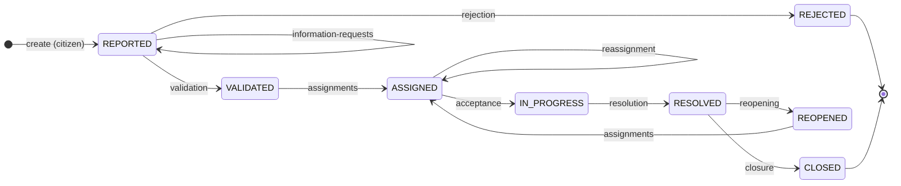

# ADR-0020: Incident lifecycle transitions

- **Status:** Proposed
- **Decision Makers:** Project Team
- **Date:** 2026-10-27

## Context

The case study lists eight states for an incident (`REPORTED`, `VALIDATED`, `REJECTED`,
`ASSIGNED`, `IN PROGRESS`, `RESOLVED`, `REOPENED`, `CLOSED`) but no transition matrix. The schema
already stores them (migration `V3__incidents_create_incident_tables.sql`):

- `incident.status` with a `CHECK` on the eight states, spelled `IN_PROGRESS` in the database,
  the API and the clients;
- `incident.version` for optimistic locking and `incident.closed_at`;
- `status_change` with actor, instant, previous and new status, reason, `associated_data` (jsonb)
  and `visible_to_citizen`.

`frontend/packages/domain/src/incident-status.ts` says the transitions are not agreed yet, and
RF09 ("request more information") has no state of its own. Several Sprint 1 and Sprint 2 features
change the status of an incident (validate, reject, assign, accept, resolve, close, reopen:
#48, #49, #51, #52). Without one shared set of rules, each feature would invent its own.

`AGENTS.md` (section 3) already requires that transition validation is centralised, that the
status and its history are persisted in one transaction, that an invalid transition leaves no
partial changes, and that concurrent edits have conflict control. This ADR fixes the rules those
requirements apply to (RF09, RF11, RF12, RF13, RF18).

**Question:** Which status changes are allowed, who can make each one and with which data, and
how is "request more information" represented?

## Decision

The allowed transitions are **one explicit table owned by the `incidents` module**
([ADR-0010](0010-modular-monolith.md)). "Request more information" **does not add a state**: the
incident stays `REPORTED` and the request is recorded in its history (option B below).

### Transition table

`—` means creation. **Operator** means `MUNICIPAL_OPERATOR` or `ADMINISTRATOR`: an administrator
can do everything an operator can. **Assigned technician** means the `TECHNICIAN` of the active
assignment of the incident.

| From | To | Domain action (sub-resource) | Who | Required data | Citizen sees |
|---|---|---|---|---|---|
| — | `REPORTED` | `POST /incidents` | Citizen | — | Status |
| `REPORTED` | `REPORTED` | `POST /incidents/{incidentId}/information-requests` | Operator | Message to the citizen | Status and message |
| `REPORTED` | `VALIDATED` | `POST /incidents/{incidentId}/validation` | Operator | Category and priority already set | Status |
| `REPORTED` | `REJECTED` | `POST /incidents/{incidentId}/rejection` | Operator | Reason | Status and reason |
| `VALIDATED`, `REOPENED` | `ASSIGNED` | `POST /incidents/{incidentId}/assignments` | Operator | Department, optional technician | Status |
| `ASSIGNED` | `ASSIGNED` | `POST /incidents/{incidentId}/assignments` (reassignment) | Operator | New assignment; the previous one is deactivated | Status |
| `ASSIGNED` | `IN_PROGRESS` | `POST /incidents/{incidentId}/acceptance` | Assigned technician | — | Status |
| `IN_PROGRESS` | `RESOLVED` | `POST /incidents/{incidentId}/resolution` | Assigned technician | Resolution notes | Status |
| `RESOLVED` | `CLOSED` | `POST /incidents/{incidentId}/closure` | Operator | — (sets `closed_at`) | Status |
| `RESOLVED` | `REOPENED` | `POST /incidents/{incidentId}/reopening` | Operator | Reason | Status |

Of the 64 origin/destination pairs between the eight states, these 10 are allowed and the other
54 are forbidden. `REJECTED` and `CLOSED` are final in this version.

### Rules

- **Domain actions, not a status field.** Each transition is its own sub-resource with the data it
  needs in the body. There is no `PATCH {"status": ...}` and no generic "set status" endpoint that
  could skip the table.
- **One place decides.** A domain component in `incidents` decides whether a transition is
  allowed (origin, destination, role, required data), with no dependency on HTTP. Every feature
  goes through the same application service (#37). The clients get the same table in
  `frontend/packages/domain` (`canTransition`) only to show or hide buttons; the backend always
  checks it.
- **One transaction.** The status change, the `status_change` row and any data the action writes
  (for example the new assignment) are persisted in one transaction. A forbidden or failed
  transition leaves neither the status nor the history changed.
- **One history entry per transition.** Every transition, including the two that keep the status,
  creates exactly one `status_change` with actor, instant (UTC), previous and new status, reason
  and associated data, and updates `incident.updated_at`.
- **Request more information.** It is stored as a `status_change` from `REPORTED` to `REPORTED`
  with the message as `reason`, `associated_data.action = INFORMATION_REQUESTED` and
  `visible_to_citizen = true`.
- **Internal data stays internal.** Internal data, such as the technician or internal notes, goes
  in `associated_data` and is never returned to citizens. A citizen gets only what the "Citizen
  sees" column says.
- **Conflicts.** A transition made on a stale `incident.version` returns `409 Conflict`. A
  transition the table forbids also returns `409`, with the code `INVALID_TRANSITION` (#33).
  Missing required data returns `422`.
- **Spelling.** The case study's `IN PROGRESS` is `IN_PROGRESS` everywhere in the code, the
  database and the API.

### What the table does not allow in this version

These follow from the table and are listed so that no feature adds them by itself:

- No rejection after validation (`VALIDATED` → `REJECTED`).
- No reassignment once the work has started (`IN_PROGRESS` → `ASSIGNED`).
- An assignment to a department only cannot be accepted: it stays `ASSIGNED` until a reassignment
  adds a technician.
- A reopened incident is assigned again before any work; it cannot be closed or rejected.
- Only operators reopen; citizens do not.
- No automatic closing after a number of days.

Each of them needs a new or superseding ADR.

**Hypothesis and evaluation:**

- If the allowed transitions are one explicit table owned by the `incidents` module, with the role
  and the data each one needs, then every feature reuses it and no forbidden transition reaches
  the database.
- **Metric:** a parameterised test over the 64 origin/destination pairs per role (#37).
- **Threshold:** 100 % of the pairs covered and 0 forbidden transitions accepted.
- **Review:** at the end of Sprint 1. Revert to option A if operators cannot tell which incidents
  are waiting for the citizen.

## Considered Options

How to represent "request more information" (RF09):

- **A. New state `INFORMATION_REQUESTED`.** Easy to filter in the inbox. But it changes the eight
  states of the case study, needs a new migration for the `CHECK` constraints of `incident` and
  `status_change`, and adds more transitions to test.
- **B. Stay in `REPORTED` and record the request in the history.** Keeps the case study states and
  needs no schema change; the request is audited with actor, instant and reason. The inbox has to
  read the last history entry to show "waiting for the citizen". Selected.
- **C. A comment visible to the citizen.** The simplest option, but it is not an auditable
  decision and it mixes collaboration (RF13) with the lifecycle (RF12).
- **D. Keep the current situation.** No table: every feature invents its own rules.

Option B was selected because it records the request as an auditable lifecycle event without
changing the states of the case study or the schema.

## Consequences

- **Positives:**
  - One rule set for the backend and the clients; the clients only use it to show or hide
    buttons.
  - The case study states and the schema are unchanged.
  - Every decision on an incident leaves one history entry with actor, instant and reason (RF18).
- **Negatives:**
  - "Waiting for the citizen" is derived from the last history entry, not stored as a state.
  - The citizen's reply to an information request is not covered (follow-up issue).
  - The cases listed in "What the table does not allow in this version" may be needed later and
    will need a new ADR.

## Links Related

- [ADR-0004: Authentication strategy](0004-authentication-strategy.md) (roles)
- [ADR-0010: Modular monolith](0010-modular-monolith.md)
- [ADR-0014: Versioned database migrations with Flyway](0014-database-migrations-flyway.md)
- Migration `V3__incidents_create_incident_tables.sql` (`incident`, `status_change`, `assignment`)
- Issue #31 (this ADR), #37 (implementation), #33 (API conventions and error codes)
- Features that use it: #48, #49, #51, #52
- C4 model: component `incidents` ("lifecycle with allowed transitions"); no container or
  component changes
