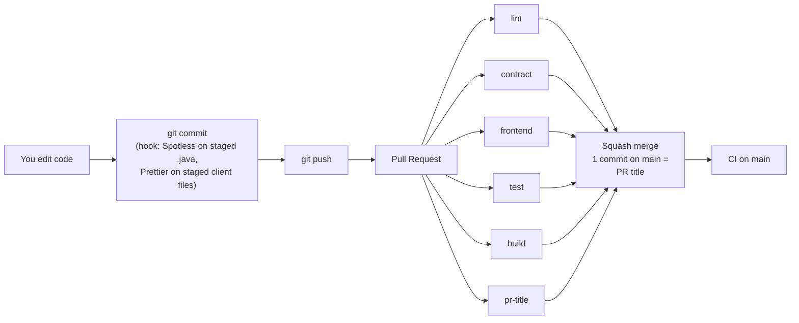

# Continuous integration (CI)

> Decision: [ADR-0015](adr/0015-ci-pipeline-and-pre-commit-formatting.md). How the tests are organised: [testing guide](testing.md). One-time setup of a clone and of the repository: [section 9](#9-setup).

## 1. What it is and the rules it follows

The CI is a set of checks that GitHub Actions runs on every Pull Request and on every push to `main`. If any of them fails, the PR cannot be merged (`main` ruleset).

Four rules drive the whole design:

1. **The CI checks; it does not modify code.** Formatting is done by the `pre-commit` hook, on your machine, before the commit exists.
2. **What passes locally passes in the CI.** `./mvnw verify` runs the same checks as the `lint` and `test` jobs, because they are bound to Maven phases in `pom.xml` and not written only in the workflow.
3. **Each job fails for a single kind of reason.** A stray space only turns `lint` red, a broken test only `test`, and a jar that does not start only `build`. You know what happened without opening the logs.
4. **Stable job names and no `paths:` filters.** They are *required checks*: if they change or do not run, every PR stays blocked.

## 2. The full flow



`lint`, `contract`, `frontend`, `test` and `build` run **in parallel**. A new push to the same PR cancels the run in progress.

## 3. Workflows and jobs

| File | When | Jobs |
|---|---|---|
| `.github/workflows/ci.yml` | PR to `main`, push to `main`, manual (*Run workflow*) | `lint`, `contract`, `frontend`, `test`, `build` |
| `.github/workflows/pr-title.yml` | When a PR to `main` is opened, edited or updated | `pr-title` |
| `.github/workflows/project-status.yml` | When a PR to `main` is opened, reopened, edited, marked ready for review or converted to draft | `project-status` |
| `.github/scripts/ci_summary.py` | Called by `test` | Test and coverage tables in the job summary |
| `.github/scripts/client_changes.sh` | Called by `frontend` | Decides whether the PR or push changed the clients, so the client checks run or are skipped |
| `.github/actions/setup-js/action.yml` | Called by `frontend` and `contract` | pnpm (from `packageManager` in `frontend/package.json`), Node (from `frontend/.nvmrc`), pnpm store cache and `pnpm install --frozen-lockfile` in `frontend/` |
| `.githooks/pre-commit` | On every local `git commit` | Formats the `.java` and client files in the commit |

> **Folders:** `.github/`, `.githooks/` and `docs/` are in the repository root; the backend is in `backend/` (`BACKEND_DIR`) and the clients are a pnpm workspace in `frontend/` (`FRONTEND_DIR`: `apps/web`, `apps/mobile`, `packages/*`, ADR-0007).

### `lint` — repository hygiene and formatting

| Step | Fails if… | Fix |
|---|---|---|
| No .env file is versioned | There is a `.env` in git | `git rm --cached .env` (it is already in `.gitignore`) |
| Same PostgreSQL image… | The image in `docker-compose.yaml` or `TestcontainersConfiguration.java` is not `POSTGRES_IMAGE` from `ci.yml` | Change the image in the three places at once |
| Docker Compose file is valid | `docker-compose.yaml` is not valid with `.env.example`. It only parses it, it does not start containers | `docker compose config` locally |
| Formatting (Spotless) | Some file is not formatted | `./mvnw spotless:apply`, commit and push |

**Local equivalent:** `./mvnw spotless:check` (or any `./mvnw verify`, which includes it in `validate`).

### `contract` — OpenAPI contract

| Step | Fails if… | Fix |
|---|---|---|
| OpenAPI contract is valid (Redocly) | `docs/api/openapi.yml` is not valid OpenAPI 3.1, or breaks a rule of `redocly.yaml`: missing or duplicated `operationId`, a tag that is not a module, more than one tag, a 4xx response that is not `application/problem+json`, a path that is not kebab-case | Fix the contract following [api.md](api.md) |
| Set up JS workspace | `pnpm install --frozen-lockfile` fails: `frontend/package.json` and `frontend/pnpm-lock.yaml` disagree | `pnpm install` in `frontend/` and commit `pnpm-lock.yaml` |
| api-client types are up to date with the contract | `pnpm generate:api` changes something in `frontend/packages/api-client`: the contract changed but the generated types were not regenerated and committed | `pnpm generate:api` in `frontend/`, commit the result, push |

It checks the contract and the types generated from it, not the Java code. The Redocly version is `REDOCLY_CLI_VERSION` in `ci.yml`.

**Local equivalent:** `npx @redocly/cli@2.71.0 lint` from the repository root, then `pnpm generate:api` and `git status packages/api-client` from `frontend/` (nothing must change).

### `frontend` — client workspace

Checks the web and mobile clients and the shared packages (ADR-0007). Node only runs here and in `contract`; the Java jobs never install Node, and this job never starts Maven.

**Only when the clients change.** The first step, *Detect client changes* (`.github/scripts/client_changes.sh`), compares the PR with its base (or a push with the previous commit) and runs the checks only if something changed under `frontend/`, `docs/api/` (the contract the `api-client` types come from), `ci.yml` or `.github/actions/setup-js/`. Otherwise every other step is skipped and the job still ends **green**, because `frontend` is a required check: a backend-only PR does not install pnpm or build the apps. A manual run, the first push of a branch or a missing base commit always run the checks. The decision is written in the job summary.

| Step | Fails if… | Fix |
|---|---|---|
| Detect client changes | Never fails on its own; it decides whether the next steps run | If the checks were skipped but should have run, add the path to `client_paths` in the script |
| Set up JS workspace | `frontend/package.json` and `frontend/pnpm-lock.yaml` disagree, or `.nvmrc` / `packageManager` are missing | `pnpm install` in `frontend/` and commit `pnpm-lock.yaml` |
| Formatting (Prettier) | A client file is not formatted | `pnpm format`, commit and push (the hook does it on commit) |
| Lint (ESLint) | An ESLint error in an app or package | `pnpm lint`, fix the reported lines |
| Type check (TypeScript) | A type error, often a shared package change that breaks an app | `pnpm typecheck` |
| Tests | A failing test in an app or package: Vitest in `apps/web` and `packages/*`, Jest (`jest-expo`) in `apps/mobile` | `pnpm test` |
| Build (web bundle and mobile export) | The web Vite build or the mobile Expo export fails | `pnpm build` |

One step per check, so the name of the red step tells you what failed. GitHub Actions sets `CI=true`, so test runners never start in watch mode.

**What the client workspace must provide** (the job relies on it):

| Item | Purpose |
|---|---|
| `packageManager` in `frontend/package.json` (e.g. `pnpm@12.x.y`) | pnpm version for CI and Corepack |
| `frontend/.nvmrc` | Node version for CI and `nvm use` |
| `frontend/pnpm-lock.yaml` committed | Frozen install and cache key |
| Scripts `format`, `format:check`, `lint`, `typecheck`, `test`, `build` in `frontend/package.json` | The checks above, over every app and package |
| Script `generate:api` in `frontend/package.json` | Regenerates `frontend/packages/api-client` from `docs/api/openapi.yml` (used by `contract`) |

**Local equivalent** (from `frontend/`): `pnpm format:check && pnpm lint && pnpm typecheck && pnpm test && pnpm build`.

### `test` — tests, coverage and static analysis

| Step | What it does | Local equivalent |
|---|---|---|
| Unit and integration tests | `*Test` with Surefire (no Docker) and `*IT` with Failsafe (PostGIS in Testcontainers) | `./mvnw verify` |
| Coverage gate | Combined line coverage (unit + integration) ≥ `jacoco.minimum.coverage` (80 %) | included in `./mvnw verify` |
| Static analysis gate | SpotBugs with no findings (`effort=Max`, `threshold=Medium`; accepted findings, each with its reason, in `backend/spotbugs-exclude.xml`) | included in `./mvnw verify` |
| Test and coverage summary | Tables on the run page (never fails) | — |
| Publish reports | `test-reports` artifact with test reports, HTML coverage and SpotBugs | `target/` |

The three gates run in separate steps so that the name of the red step tells you which one failed.

`merge-coverage` is bound to the `verify` phase, so `./mvnw verify` generates `target/jacoco-merged.exec` and `target/site/jacoco-merged/jacoco.csv`.

### `build` — one artifact per commit and smoke test

| Step | Fails if… |
|---|---|
| Build the image | `backend/Dockerfile` does not build: the jar does not compile or package, or the build produces more than one jar |
| Start PostGIS | The database does not start within 120 s |
| Smoke test — `/actuator/health` UP | The container does not start **with environment variables only** (`SERVER_PORT=9090`, `SPRING_DATASOURCE_*`) or the health is not `UP` |
| Smoke test — not root | The process in the container runs as root |
| Smoke test — SIGTERM | The container does not stop within 30 s after `docker stop` (SIGTERM) and is killed |
| Extract the jar and publish it | — (`urbanpulse-<sha>` artifact, 7 days) |

The image is the artifact ([ADR-0011](adr/0011-deployment-12factor.md)): the jar is compiled once, inside the image, and the published jar is copied out of the image that passed the smoke test. The image is not pushed to any registry yet.

The smoke test uses `docker run` with the PostGIS image on a Docker network, **not `docker compose`**. The packaged jar does not include Spring Boot's Docker Compose support, which is why the connection comes through `SPRING_DATASOURCE_*` and not through `application.yml`: locally, Spring Boot starts the Compose file and infers the URL and credentials.

The Maven dependencies are downloaded again on every run, because the build runs inside Docker and does not use the `setup-java` cache. If the job gets slow, see [7.6 Caching](#76-caching).

The health step needs `/actuator/health` to stay unprotected: `SecurityConfig` (`shared.security`) leaves `/actuator/health/**` open ([security guide](security.md)). Any **mandatory** property that gets added must also be passed as an environment variable in the smoke test step, as `JWT_SECRET` already is.

### `pr-title` — PR title

- **Error** if the title does not follow Conventional Commits: `type(optional scope)!: description`, with type `feat|fix|docs|style|refactor|perf|test|build|ci|chore|revert`. It runs again when the title is edited.
- **Warning** (does not fail) if the description has no `Closes #N` / `Fixes #N`.

It matters because, with squash merge, **the PR title is the commit message on `main`**.

### `project-status` — project board

Moves the issues the PR closes (`Closes #N`) on the project board: a **draft** PR puts them in **In progress**, a PR **ready for review** puts them in **In review**. An issue not yet on the board is added. The board's own workflows cover the rest: *Item added* puts new issues in **Backlog**, and *Item closed* / *Pull request merged* put them in **Done**. Only **Backlog → Ready** is manual.

It is automation, **not a required check**: never add it to the ruleset.

| Result | When | Fix |
|---|---|---|
| **Warning** | The PR does not close any issue | Add `Closes #N` to the description; editing it runs the job again |
| **Error** | The `PROJECT_TOKEN` secret is missing or expired (401) | The maintainer replaces the secret (see below) |
| **Error** | The board, its `Status` field or the `In progress` / `In review` option was not found | Restore the column name, or change `STATUS_*` in the workflow |

- The board's *Pull request linked to issue* workflow must stay **off**: it would move the cards on its own and fight this job.
- It runs on `pull_request_target`, so GitHub always runs **the version on `main`**, never the one in the PR. A PR cannot change the workflow to read the token, and the job never checks out the PR code. The consequence: a change to this workflow only takes effect after it is merged, and it cannot be tested on its own PR.
- PRs from forks are skipped.

**Token.** The default `GITHUB_TOKEN` cannot write to a project owned by a user account, so the job uses the repository secret `PROJECT_TOKEN`: a classic personal access token of the board owner with **only** the `project` scope (the repository is public, so `repo` is not needed). It can edit every board of that account, but it is only readable by the workflows on `main`; collaborators cannot see it. When it expires, the job fails with 401: the owner creates a new token and replaces the secret in *Settings → Secrets and variables → Actions*.

## 4. Formatting: local hook + CI check

```
git commit
  └─ .githooks/pre-commit
       ├─ Java: any .java in the commit?  no → skip (Maven is not started)
       │    ├─ any of them with unstaged changes?  yes → stop and explain what to do
       │    ├─ ./mvnw spotless:apply  -DspotlessFiles=<only those files>
       │    └─ git add the ones that changed → they go in the SAME commit
       └─ Clients: any TS, JS, CSS, JSON, YAML or HTML under frontend/?  no → skip (pnpm is not started)
            ├─ any of them with unstaged changes?  yes → stop and explain what to do
            ├─ pnpm exec prettier --write <only those files>   (from frontend/)
            └─ git add the ones that changed → they go in the SAME commit
```

- **It creates no extra commits** and rewrites no history: it formats before the commit exists.
- **It only touches the files in the commit.** The rest of your uncommitted work does not change.
- It takes a few seconds (Maven startup) only when the commit includes `.java` files.
- **Skip it once:** `SKIP_FORMAT=1 git commit …` or `git commit --no-verify`. `lint` will catch it.
- **If Maven cannot start** (e.g. `JAVA_HOME` pointing to an old JDK, or GitHub Desktop's Git not understanding the JDK path), the hook **does not block**: it warns that it did not format, shows the cause and lets the commit through. `lint` will catch it. If the failure comes from Spotless (a `.java` with a syntax error), it does block and shows the first lines of the error.
- **Same rule for the clients:** if `pnpm` is not installed or `pnpm install` was never run, the hook warns and lets the commit through, and `frontend` will catch it. A client file with a syntax error blocks the commit.
- **Execute permission:** the file must be in Git as `100755` (`git ls-files --stage .githooks/pre-commit`). On Windows it is set with `git update-index --chmod=+x .githooks/pre-commit`; without it, Git silently ignores the hook on Linux/macOS.
- **JDK:** the hook uses the `JAVA_HOME` of the process that runs `git commit`. Set JDK 25 as a **user** variable (see [9.1 The hook in every clone](#91-the-hook-in-every-clone)).

**When `lint` can fail on formatting** (and only then):

| Cause | Fix |
|---|---|
| The hook is not installed in that clone | `git config core.hooksPath .githooks` (or any `./mvnw test`) |
| Commit made from the GitHub web UI (hooks do not run there) | `git pull`, `./mvnw spotless:apply`, commit, push |
| `SKIP_FORMAT=1` / `--no-verify` | Same as above |
| IntelliJ with *Run Git hooks* turned off | Turn it on in the commit window |
| Maven could not start when committing (old `JAVA_HOME`, GitHub Desktop) | `./mvnw spotless:apply`, commit and push; and fix `JAVA_HOME` |
| `frontend` fails on Prettier: pnpm or `frontend/node_modules` missing when committing | `pnpm install` and `pnpm format` in `frontend/`, commit and push |

**To make the IDE write formatted code from the start** (optional, avoids diffs when committing):
- `.editorconfig` (already in the repo) sets 4-space indentation, LF, no trailing spaces and 100 columns. IntelliJ reads it on its own; in VS Code, install the *EditorConfig* extension.
- IntelliJ: **google-java-format** plugin → *Settings → google-java-format Settings* → *Enable* and style **Android Open Source Project (AOSP)**.

## 5. Test contract

Unit tests are `*Test` (Surefire, no Docker) and integration tests are `*IT` (Failsafe, PostGIS in Testcontainers); the `test` job runs both. The naming rules, the coverage threshold and the client test runners are in the [testing guide](testing.md).

## 6. Squash merge and history

Only squash merge is allowed (`main` ruleset). Each PR becomes a single commit on `main` with the PR title as its message. Therefore:

- On your branch you can make as many commits as you like; they do not reach `main`.
- What matters is the **PR title**, and `pr-title` validates it.
- `main` stays linear and readable (`git log --oneline`), and can be used to generate a changelog.

## 7. How to scale the CI

Recipes for when the project grows. General rule: **if you add or rename a job, update the `main` ruleset** ([9.3](#93-protect-main-with-a-ruleset)) and this guide.

### 7.1 New modules (ADR-0010)

Nothing to change in the CI. Each module's tests are picked up by name (`*Test` / `*IT`). Keep the naming convention.

### 7.2 Database migrations

Nothing to change in the CI either: the `*IT` tests and the smoke test start the app against an empty DB, so migrations run and are tested in both. With `ddl-auto: validate`, an entity that does not match its migration breaks `test` and `build`, which is what we want.

### 7.3 New endpoints in the smoke test

Once `/api/v1/status` exists, add this to the health step of the `build` job, after the loop:

```bash
curl -fsS "http://localhost:$SMOKE_PORT/api/v1/status" | tee -a "$GITHUB_STEP_SUMMARY"
```

### 7.4 A new backing service (Redis, RabbitMQ…)

It has to be changed in four places, always with the same image:

1. `docker-compose.yaml` (local development).
2. `TestcontainersConfiguration.java`: one more `@Bean @ServiceConnection` (`RedisContainer`, `RabbitMQContainer`…).
3. `build` job: one more `docker run -d --network smoke …` and its `SPRING_…` variables as `-e` options of the `smoke-app` container, if the app needs it to start.
4. `ci.yml`: a `REDIS_IMAGE` variable and its line in the *Same … image* step of `lint`.

### 7.5 Tests take too long: split unit and integration

When `test` goes over about 8 minutes, split it into two parallel jobs and one coverage job:

```yaml
  test-unit:
    name: test-unit
    runs-on: ubuntu-latest
    steps:
      - uses: actions/checkout@v7
      - uses: actions/setup-java@v6
        with: { distribution: temurin, java-version: "25", cache: maven }
      - run: ./mvnw -Dspotless.check.skip=true -Dspotbugs.skip=true test
      - uses: actions/upload-artifact@v7
        with: { name: coverage-unit, path: target/jacoco.exec, retention-days: 1 }

  test-integration:
    name: test-integration
    runs-on: ubuntu-latest
    steps:
      # same as test-unit, but:
      - run: ./mvnw -Dspotless.check.skip=true -Dspotbugs.skip=true -DskipUTs=true -Djacoco.haltOnFailure=false verify
      - uses: actions/upload-artifact@v7
        with: { name: coverage-it, path: target/jacoco-it.exec, retention-days: 1 }

  quality:
    name: quality
    needs: [test-unit, test-integration]
    runs-on: ubuntu-latest
    steps:
      # checkout + setup-java, then:
      - uses: actions/download-artifact@v8
        with: { pattern: coverage-*, merge-multiple: true, path: target }
      - run: ./mvnw -Dspotless.check.skip=true compile jacoco:merge@merge-coverage jacoco:report@report-coverage jacoco:check@check-coverage spotbugs:check
```

Then, in the ruleset, replace `test` with `test-unit`, `test-integration` and `quality`.

### 7.6 Caching

- **Maven dependencies:** already on in `lint` and `test` (`cache: maven` in `setup-java`, keyed on the hash of `pom.xml`). The `build` job compiles inside Docker and downloads them on every run; if that becomes slow, cache the BuildKit layers with `docker/build-push-action` and `cache-from: type=gha`.
- **Frontend:** already on: `.github/actions/setup-js` caches the pnpm store, keyed on the hash of `frontend/pnpm-lock.yaml`.
- **Testcontainers Docker images:** GitHub runners already ship Docker and pull the image in a few seconds. Caching them is not worth it unless you hit Docker Hub limits.

### 7.7 Changing the Java version

`JAVA_VERSION` in `ci.yml`, `java.version` in `pom.xml` and the two Temurin image tags in `backend/Dockerfile`, in the same PR.


## 8. How to make sure the CI works and does not fail for silly reasons

### 8.1 Before pushing

```bash
./mvnw verify          # lint + test, same as the CI (needs Docker)
```

For the clients and the contract (Redocly from the repository root, pnpm from `frontend/`):

```bash
cd frontend && pnpm format:check && pnpm lint && pnpm typecheck && pnpm test && pnpm build   # frontend
npx @redocly/cli@2.71.0 lint && cd frontend && pnpm generate:api                             # contract (then git status: nothing changed)
```

The pre-commit hook formats what you commit; to format by hand, run `./mvnw spotless:apply` from `backend/` and `pnpm format` from `frontend/`.

If they pass locally, `lint`, `contract`, `frontend` and `test` pass in the CI. The only thing they do not cover is the `build` smoke test (building and starting the image), which can be reproduced from `backend/`:

```bash
docker compose --profile app up --build
# in another terminal: curl localhost:8080/actuator/health
```

### 8.2 When changing a workflow

1. Validate it before pushing with [actionlint](https://github.com/rhysd/actionlint): `pipx run actionlint` or `brew install actionlint`, then `actionlint`.
2. Push it on a `ci/...` branch and open a PR. The PR's workflow is the one on the branch, so you test the change without touching `main`.
3. If you rename or add a job, update the ruleset **before** merging.

## 9. Setup

One-time steps for a new clone (9.1) and for the repository settings the CI relies on (9.2, 9.3). The pipeline was first rolled out on a `boilerplate` integration branch, one commit per step; that history is in `git log`.

### 9.1 The hook in every clone

Nobody on the team has to do anything special: the first `./mvnw test`, `verify`, `package` or `spring-boot:run` in a clone runs the `install-git-hooks` profile of `pom.xml`, which sets `core.hooksPath`. To install it before building:

```bash
git config core.hooksPath .githooks
```

Check it with `git config --get core.hooksPath` (it prints `.githooks`).

- **JDK 25** must be the one Maven sees (`JAVA_HOME`): it is the `JAVA_VERSION` of the CI and the `java.version` of `pom.xml`. With any other JDK the build fails.
- **IntelliJ IDEA:** in the commit window, ⚙ → turn on **Run Git hooks** (on by default).
- **VS Code, GitHub Desktop and the terminal** always run the hooks. **GitHub Desktop** uses its own bundled Git and may not read `JAVA_HOME` correctly; see the table below.
- **Windows:** Git for Windows runs the hook with its `sh`. It works thanks to `.gitattributes`, which forces LF on `.githooks/*`.
- If you already used another hook manager (Husky, pre-commit…), `core.hooksPath` replaces it. Move those hooks to `.githooks/`.

**Windows tricks worth knowing:**

| What | Command | Why |
|---|---|---|
| Set JDK 25 permanently (a **user** variable, which takes precedence over the system one) | `[Environment]::SetEnvironmentVariable("JAVA_HOME", "C:\path\to\jdk-25", "User")` and **restart** IntelliJ, GitHub Desktop and your terminals | A system `JAVA_HOME` pointing to another JDK makes the hook and Maven fail outside your terminal. `$env:JAVA_HOME = ...` only works in that window |
| Check which JDK Maven uses | `./mvnw -v` (`Java version` line) | It must say 25 |
| Make the hook executable | `git update-index --chmod=+x .githooks/pre-commit` | Windows does not store permissions; without this, Git silently ignores the hook on Linux/macOS |
| Check the permission | `git ls-files --stage .githooks/pre-commit` | It must start with `100755` (not `100644`). Repeat it if the file is recreated (`reset --hard`, copied again) |
| Avoid the `LF will be replaced by CRLF` warning | `git config core.autocrlf false` (in this repo) | `.gitattributes` already forces LF |
| Leave Git's `(END)` screen | `q`, or use `git --no-pager <command>` | It is the pager |

**Common errors:**

| Symptom | Cause | Fix |
|---|---|---|
| `ExceptionInInitializerError: com.sun.tools.javac.tree.EndPosTable` | Maven runs with a JDK newer than what Lombok supports | `./mvnw -v` must say 25; set `JAVA_HOME` as above |
| `release version 25 not supported` | Maven runs with an older JDK (old system `JAVA_HOME`) | A **user** variable with JDK 25, and restart the programs |
| GitHub Desktop: `The JAVA_HOME environment variable is not defined correctly` / `cd: /home/...: No such file` | GitHub Desktop's bundled Git mangles the `JAVA_HOME` path | The hook warns and lets the commit through. To format: `./mvnw spotless:apply`, or commit from the terminal or IntelliJ |
| IntelliJ: `Plugin 'org.codehaus.mojo:exec-maven-plugin:' not found` | IntelliJ has not reloaded `pom.xml` | Maven → *Reload All Projects*. VS Code: *Java: Update Project* |
| A Spring test named `*Tests` runs under Surefire and needs Docker | Integration tests must be `*IT` | Rename it to `*IT` with `git mv` and import `TestcontainersConfiguration` |

### 9.2 Squash merge

In **Settings → General → Pull Requests**:

1. Uncheck **Allow merge commits**.
2. Check **Allow squash merging** and, under *Default commit message*, choose **Pull request title and description** (or just **Pull request title**).
3. Uncheck **Allow rebase merging**.
4. Check **Always suggest updating pull request branches** and **Automatically delete head branches**.

Result: each PR enters `main` as **a single commit** whose message is the PR title, already validated by `pr-title` (section 6).

### 9.3 Protect `main` with a ruleset

> A check only shows up in the ruleset search **after it has run once**.

In **Settings → Rules → Rulesets → New ruleset → New branch ruleset**:

| Field | Value |
|---|---|
| Ruleset name | `main` |
| Enforcement status | **Active** |
| Target branches | **Include default branch** |
| Restrict deletions | ✅ |
| Require linear history | ✅ (fits with squash) |
| Require a pull request before merging | ✅ · *Required approvals*: 1 · *Allowed merge methods*: **Squash** |
| Require status checks to pass | ✅ · *Require branches to be up to date before merging* · add `lint`, `contract`, `frontend`, `test`, `build`, `pr-title` (source: GitHub Actions) |
| Block force pushes | ✅ |

A second ruleset, `release-tags`, protects the `v*` tags: they cannot be deleted, moved or force-pushed.

### 9.4 Reproduce the smoke test by hand

The `build` job starts the jar with environment variables only. To reproduce it outside Docker Compose (PowerShell; in bash use `export`), from `backend/`:

```powershell
docker run -d --name smoke-db -p 5432:5432 -e POSTGRES_DB=urbanpulse -e POSTGRES_USER=urbanpulse -e POSTGRES_PASSWORD=smoke postgis/postgis:18-3.6
./mvnw "-Dspotless.check.skip=true" -DskipTests package
$env:SERVER_PORT="9090"
$env:JWT_SECRET="smoke-test-secret-of-at-least-thirty-two-bytes"
$env:SPRING_DATASOURCE_URL="jdbc:postgresql://localhost:5432/urbanpulse"
$env:SPRING_DATASOURCE_USERNAME="urbanpulse"
$env:SPRING_DATASOURCE_PASSWORD="smoke"
java -jar (Get-ChildItem target\*.jar | Where-Object Name -notlike "*.original").FullName
# in another terminal:
curl.exe -i http://localhost:9090/actuator/health      # 200 and "status":"UP"
```

When you are done: `docker rm -f smoke-db` and close that terminal (the `$env:` variables only live in it). Stop the local Compose database first if it already uses port 5432.
