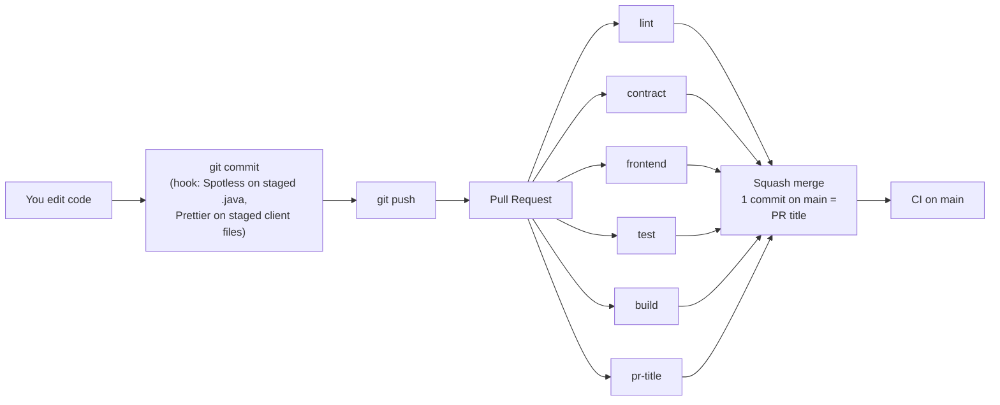

# Continuous integration (CI)

> Initial rollout: [ci-setup.md](ci-setup.md). Decision: [ADR-0015](adr/0015-ci-pipeline-and-pre-commit-formatting.md).

## 1. What it is and the rules it follows

The CI is a set of checks that GitHub Actions runs on every Pull Request and on every push to `main`. If any of them fails, the PR cannot be merged (`main` ruleset).

Four rules drive the whole design:

1. **The CI checks; it does not modify code.** Formatting is done by the `pre-commit` hook, on your machine, before the commit exists.
2. **What passes locally passes in the CI.** `./mvnw verify` runs the same checks as the `lint` and `test` jobs, because they are bound to Maven phases in `pom.xml` and not written only in the workflow.
3. **Each job fails for a single kind of reason.** A stray space only turns `lint` red, a broken test only `test`, and a jar that does not start only `build`. You know what happened without opening the logs.
4. **Stable job names and no `paths:` filters.** They are *required checks*: if they change or do not run, every PR stays blocked.

## 2. The full flow



`lint`, `contract`, `frontend`, `test` and `build` run **in parallel**. A new push to the same PR cancels the run in progress.

## 3. Workflows and jobs

| File | When | Jobs |
|---|---|---|
| `.github/workflows/ci.yml` | PR to `main`, push to `main`, manual (*Run workflow*) | `lint`, `contract`, `frontend`, `test`, `build` |
| `.github/workflows/pr-title.yml` | When a PR to `main` is opened, edited or updated | `pr-title` |
| `.github/scripts/ci_summary.py` | Called by `test` | Test and coverage tables in the job summary |
| `.github/scripts/client_changes.sh` | Called by `frontend` | Decides whether the PR or push changed the clients, so the client checks run or are skipped |
| `.github/actions/setup-js/action.yml` | Called by `frontend` and `contract` | pnpm (from `packageManager` in `frontend/package.json`), Node (from `frontend/.nvmrc`), pnpm store cache and `pnpm install --frozen-lockfile` in `frontend/` |
| `.githooks/pre-commit` | On every local `git commit` | Formats the `.java` and client files in the commit |

> **Temporary triggers:** while the CI is being tested on `boilerplate`, `branches` also includes `boilerplate` (comment `# TEMPORARY`). It is removed when moving to `main`; see [ci-setup.md section 6](ci-setup.md#6-test-on-boilerplate-before-main).
>
> **Folders:** `.github/`, `.githooks/` and `docs/` are in the repository root; the backend is in `backend/` (`BACKEND_DIR`) and the clients are a pnpm workspace in `frontend/` (`FRONTEND_DIR`: `apps/web`, `apps/mobile`, `packages/*`, ADR-0007).

### `lint` — repository hygiene and formatting

| Step | Fails if… | Fix |
|---|---|---|
| No .env file is versioned | There is a `.env` in git | `git rm --cached .env` (it is already in `.gitignore`) |
| Same PostgreSQL image… | The image in `docker-compose.yaml` or `TestcontainersConfiguration.java` is not `POSTGRES_IMAGE` from `ci.yml` | Change the image in the three places at once |
| Docker Compose file is valid | `docker-compose.yaml` is not valid with `.env.example`. It only parses it, it does not start containers | `docker compose config` locally |
| Formatting (Spotless) | Some file is not formatted | `./mvnw spotless:apply`, commit and push |

**Local equivalent:** `./mvnw spotless:check` (or any `./mvnw verify`, which includes it in `validate`).

### `contract` — OpenAPI contract

| Step | Fails if… | Fix |
|---|---|---|
| OpenAPI contract is valid (Redocly) | `docs/api/openapi.yml` is not valid OpenAPI 3.1, or breaks a rule of `redocly.yaml`: missing or duplicated `operationId`, a tag that is not a module, more than one tag, a 4xx response that is not `application/problem+json`, a path that is not kebab-case | Fix the contract following [api.md](api.md) |
| Set up JS workspace | `pnpm install --frozen-lockfile` fails: `frontend/package.json` and `frontend/pnpm-lock.yaml` disagree | `pnpm install` in `frontend/` and commit `pnpm-lock.yaml` |
| api-client types are up to date with the contract | `pnpm generate:api` changes something in `frontend/packages/api-client`: the contract changed but the generated types were not regenerated and committed | `pnpm generate:api` in `frontend/`, commit the result, push |

It checks the contract and the types generated from it, not the Java code. The Redocly version is `REDOCLY_CLI_VERSION` in `ci.yml`.

**Local equivalent:** `npx @redocly/cli@2.71.0 lint` from the repository root, then `pnpm generate:api` and `git status packages/api-client` from `frontend/` (nothing must change).

### `frontend` — client workspace

Checks the web and mobile clients and the shared packages (ADR-0007). Node only runs here and in `contract`; the Java jobs never install Node, and this job never starts Maven.

**Only when the clients change.** The first step, *Detect client changes* (`.github/scripts/client_changes.sh`), compares the PR with its base (or a push with the previous commit) and runs the checks only if something changed under `frontend/`, `docs/api/` (the contract the `api-client` types come from), `ci.yml` or `.github/actions/setup-js/`. Otherwise every other step is skipped and the job still ends **green**, because `frontend` is a required check: a backend-only PR does not install pnpm or build the apps. A manual run, the first push of a branch or a missing base commit always run the checks. The decision is written in the job summary.

| Step | Fails if… | Fix |
|---|---|---|
| Detect client changes | Never fails on its own; it decides whether the next steps run | If the checks were skipped but should have run, add the path to `client_paths` in the script |
| Set up JS workspace | `frontend/package.json` and `frontend/pnpm-lock.yaml` disagree, or `.nvmrc` / `packageManager` are missing | `pnpm install` in `frontend/` and commit `pnpm-lock.yaml` |
| Formatting (Prettier) | A client file is not formatted | `pnpm format`, commit and push (the hook does it on commit) |
| Lint (ESLint) | An ESLint error in an app or package | `pnpm lint`, fix the reported lines |
| Type check (TypeScript) | A type error, often a shared package change that breaks an app | `pnpm typecheck` |
| Tests | A failing test in an app or package | `pnpm test` |
| Build (web bundle and mobile export) | The web Vite build or the mobile Expo export fails | `pnpm build` |

One step per check, so the name of the red step tells you what failed. GitHub Actions sets `CI=true`, so test runners never start in watch mode.

**What the client workspace must provide** (the job relies on it):

| Item | Purpose |
|---|---|
| `packageManager` in `frontend/package.json` (e.g. `pnpm@12.x.y`) | pnpm version for CI and Corepack |
| `frontend/.nvmrc` | Node version for CI and `nvm use` |
| `frontend/pnpm-lock.yaml` committed | Frozen install and cache key |
| Scripts `format`, `format:check`, `lint`, `typecheck`, `test`, `build` in `frontend/package.json` | The checks above, over every app and package |
| Script `generate:api` in `frontend/package.json` | Regenerates `frontend/packages/api-client` from `docs/api/openapi.yml` (used by `contract`) |

**Local equivalent** (from `frontend/`): `pnpm format:check && pnpm lint && pnpm typecheck && pnpm test && pnpm build`.

### `test` — tests, coverage and static analysis

| Step | What it does | Local equivalent |
|---|---|---|
| Unit and integration tests | `*Test` with Surefire (no Docker) and `*IT` with Failsafe (PostGIS in Testcontainers) | `./mvnw verify` |
| Coverage gate | Combined line coverage (unit + integration) ≥ `jacoco.minimum.coverage` (80 %) | included in `./mvnw verify` |
| Static analysis gate | SpotBugs with no findings (`effort=Max`, `threshold=Medium`) | included in `./mvnw verify` |
| Test and coverage summary | Tables on the run page (never fails) | — |
| Publish reports | `test-reports` artifact with test reports, HTML coverage and SpotBugs | `target/` |

The three gates run in separate steps so that the name of the red step tells you which one failed.

`merge-coverage` is bound to the `verify` phase, so `./mvnw verify` generates `target/jacoco-merged.exec` and `target/site/jacoco-merged/jacoco.csv`. While only `UrbanpulseApplication` exists (excluded from the report), coverage comes out empty (`—`) and the 80 % gate evaluates nothing. It will start to apply once there is real code.

### `build` — one artifact per commit and smoke test

| Step | Fails if… |
|---|---|
| Package | It does not compile or package (`./mvnw -DskipTests package`) |
| Exactly one jar per commit | There is more than one `.jar` in `target/` |
| Start PostGIS | The database does not start within 120 s |
| Smoke test — `/actuator/health` UP | The jar does not start **with environment variables only** (`SERVER_PORT=9090`, `SPRING_DATASOURCE_*`) or the health is not `UP` |
| Smoke test — SIGTERM | The app does not stop within 30 s after SIGTERM |
| Publish the jar | — (`urbanpulse-<sha>` artifact, 7 days) |

The smoke test uses `docker run` with the PostGIS image, **not `docker compose`**. The packaged jar does not include Spring Boot's Docker Compose support, which is why the connection comes through `SPRING_DATASOURCE_*` and not through `application.yml`: locally, Spring Boot starts the Compose file and infers the URL and credentials.

The health step needs `/actuator/health` to be unprotected: with `spring-boot-starter-security`, `SecurityConfig` opens only `/actuator/health/**`. When the JWT filter is implemented, that bean is the one to replace, keeping the health endpoint open. Any **mandatory** property that gets added (e.g. a JWT secret) must also be passed as an environment variable in the smoke test step.

### `pr-title` — PR title

- **Error** if the title does not follow Conventional Commits: `type(optional scope)!: description`, with type `feat|fix|docs|style|refactor|perf|test|build|ci|chore|revert`. It runs again when the title is edited.
- **Warning** (does not fail) if the description has no `Closes #N` / `Fixes #N`.

It matters because, with squash merge, **the PR title is the commit message on `main`**.

## 4. Formatting: local hook + CI check

```
git commit
  └─ .githooks/pre-commit
       ├─ Java: any .java in the commit?  no → skip (Maven is not started)
       │    ├─ any of them with unstaged changes?  yes → stop and explain what to do
       │    ├─ ./mvnw spotless:apply  -DspotlessFiles=<only those files>
       │    └─ git add the ones that changed → they go in the SAME commit
       └─ Clients: any TS, JS, CSS, JSON, YAML or HTML under frontend/?  no → skip (pnpm is not started)
            ├─ any of them with unstaged changes?  yes → stop and explain what to do
            ├─ pnpm exec prettier --write <only those files>   (from frontend/)
            └─ git add the ones that changed → they go in the SAME commit
```

- **It creates no extra commits** and rewrites no history: it formats before the commit exists.
- **It only touches the files in the commit.** The rest of your uncommitted work does not change.
- It takes a few seconds (Maven startup) only when the commit includes `.java` files.
- **Skip it once:** `SKIP_FORMAT=1 git commit …` or `git commit --no-verify`. `lint` will catch it.
- **If Maven cannot start** (e.g. `JAVA_HOME` pointing to an old JDK, or GitHub Desktop's Git not understanding the JDK path), the hook **does not block**: it warns that it did not format, shows the cause and lets the commit through. `lint` will catch it. If the failure comes from Spotless (a `.java` with a syntax error), it does block and shows the first lines of the error.
- **Same rule for the clients:** if `pnpm` is not installed or `pnpm install` was never run, the hook warns and lets the commit through, and `frontend` will catch it. A client file with a syntax error blocks the commit.
- **Execute permission:** the file must be in Git as `100755` (`git ls-files --stage .githooks/pre-commit`). On Windows it is set with `git update-index --chmod=+x .githooks/pre-commit`; without it, Git silently ignores the hook on Linux/macOS.
- **JDK:** the hook uses the `JAVA_HOME` of the process that runs `git commit`. Set JDK 25 as a **user** variable (see [ci-setup.md section 2](ci-setup.md#2-the-hook-in-every-clone)).

**When `lint` can fail on formatting** (and only then):

| Cause | Fix |
|---|---|
| The hook is not installed in that clone | `git config core.hooksPath .githooks` (or any `./mvnw test`) |
| Commit made from the GitHub web UI (hooks do not run there) | `git pull`, `./mvnw spotless:apply`, commit, push |
| `SKIP_FORMAT=1` / `--no-verify` | Same as above |
| IntelliJ with *Run Git hooks* turned off | Turn it on in the commit window |
| Maven could not start when committing (old `JAVA_HOME`, GitHub Desktop) | `./mvnw spotless:apply`, commit and push; and fix `JAVA_HOME` |
| `frontend` fails on Prettier: pnpm or `frontend/node_modules` missing when committing | `pnpm install` and `pnpm format` in `frontend/`, commit and push |

**To make the IDE write formatted code from the start** (optional, avoids diffs when committing):
- `.editorconfig` (already in the repo) sets 4-space indentation, LF, no trailing spaces and 100 columns. IntelliJ reads it on its own; in VS Code, install the *EditorConfig* extension.
- IntelliJ: **google-java-format** plugin → *Settings → google-java-format Settings* → *Enable* and style **Android Open Source Project (AOSP)**.

## 5. Test contract

| Type | Class name | Plugin | Needs | Run with |
|---|---|---|---|---|
| Unit | `*Test`, `*Tests` | Surefire | Nothing (no Docker, no DB) | `./mvnw test` |
| Integration | `*IT` | Failsafe | Docker (Testcontainers) | `./mvnw verify` |

- Tests **never use `docker-compose.yaml`**. An `*IT` imports `TestcontainersConfiguration`, which starts a throwaway PostGIS, and Spring connects to it with `@ServiceConnection`. No `.env` or local DB is needed.
- Coverage: `jacoco.minimum.coverage` in `pom.xml` (80 % of lines, combining unit and integration). `*Application` is excluded.

## 6. Squash merge and history

Only squash merge is allowed (`main` ruleset). Each PR becomes a single commit on `main` with the PR title as its message. Therefore:

- On your branch you can make as many commits as you like; they do not reach `main`.
- What matters is the **PR title**, and `pr-title` validates it.
- `main` stays linear and readable (`git log --oneline`), and can be used to generate a changelog.

## 7. How to scale the CI

Recipes for when the project grows. General rule: **if you add or rename a job, update the `main` ruleset** (ci-setup.md section 4) and this guide.

### 7.1 New modules (ADR-0010)

Nothing to change in the CI. Each module's tests are picked up by name (`*Test` / `*IT`). Keep the naming convention.

### 7.2 Database migrations

Nothing to change in the CI either: the `*IT` tests and the smoke test start the app against an empty DB, so migrations run and are tested in both. With `ddl-auto: validate`, an entity that does not match its migration breaks `test` and `build`, which is what we want.

### 7.3 New endpoints in the smoke test

Once `/api/v1/status` exists, add this to the health step of the `build` job, after the loop:

```bash
curl -fsS "http://localhost:$SMOKE_PORT/api/v1/status" | tee -a "$GITHUB_STEP_SUMMARY"
```

### 7.4 A new backing service (Redis, RabbitMQ…)

It has to be changed in four places, always with the same image:

1. `docker-compose.yaml` (local development).
2. `TestcontainersConfiguration.java`: one more `@Bean @ServiceConnection` (`RedisContainer`, `RabbitMQContainer`…).
3. `build` job: one more `docker run -d …` and its `SPRING_…` variables, if the app needs it to start.
4. `ci.yml`: a `REDIS_IMAGE` variable and its line in the *Same … image* step of `lint`.

### 7.5 Tests take too long: split unit and integration

When `test` goes over about 8 minutes, split it into two parallel jobs and one coverage job:

```yaml
  test-unit:
    name: test-unit
    runs-on: ubuntu-latest
    steps:
      - uses: actions/checkout@v7
      - uses: actions/setup-java@v6
        with: { distribution: temurin, java-version: "25", cache: maven }
      - run: ./mvnw -Dspotless.check.skip=true -Dspotbugs.skip=true test
      - uses: actions/upload-artifact@v7
        with: { name: coverage-unit, path: target/jacoco.exec, retention-days: 1 }

  test-integration:
    name: test-integration
    runs-on: ubuntu-latest
    steps:
      # same as test-unit, but:
      - run: ./mvnw -Dspotless.check.skip=true -Dspotbugs.skip=true -DskipUTs=true -Djacoco.haltOnFailure=false verify
      - uses: actions/upload-artifact@v7
        with: { name: coverage-it, path: target/jacoco-it.exec, retention-days: 1 }

  quality:
    name: quality
    needs: [test-unit, test-integration]
    runs-on: ubuntu-latest
    steps:
      # checkout + setup-java, then:
      - uses: actions/download-artifact@v8
        with: { pattern: coverage-*, merge-multiple: true, path: target }
      - run: ./mvnw -Dspotless.check.skip=true compile jacoco:merge@merge-coverage jacoco:report@report-coverage jacoco:check@check-coverage spotbugs:check
```

Then, in the ruleset, replace `test` with `test-unit`, `test-integration` and `quality`.

### 7.6 Caching

- **Maven dependencies:** already on (`cache: maven` in `setup-java`, keyed on the hash of `pom.xml`). Nothing to do.
- **Frontend:** already on: `.github/actions/setup-js` caches the pnpm store, keyed on the hash of `frontend/pnpm-lock.yaml`.
- **Testcontainers Docker images:** GitHub runners already ship Docker and pull the image in a few seconds. Caching them is not worth it unless you hit Docker Hub limits.

### 7.7 Changing the Java version

`JAVA_VERSION` in `ci.yml` and `java.version` in `pom.xml`, in the same PR.


## 8. How to make sure the CI works and does not fail for silly reasons

### 8.1 Before pushing

```bash
./mvnw verify          # lint + test, same as the CI (needs Docker)
```

For the clients and the contract (Redocly from the repository root, pnpm from `frontend/`):

```bash
cd frontend && pnpm format:check && pnpm lint && pnpm typecheck && pnpm test && pnpm build   # frontend
npx @redocly/cli@2.71.0 lint && cd frontend && pnpm generate:api                             # contract (then git status: nothing changed)
```

If they pass locally, `lint`, `contract`, `frontend` and `test` pass in the CI. The only thing they do not cover is the `build` smoke test (starting the jar), which can be reproduced:

```bash
docker compose up -d
./mvnw -DskipTests package
SPRING_DATASOURCE_URL=jdbc:postgresql://localhost:5432/urbanpulse \
SPRING_DATASOURCE_USERNAME=urbanpulse SPRING_DATASOURCE_PASSWORD=change_me \
SERVER_PORT=9090 java -jar target/*.jar
# in another terminal: curl localhost:9090/actuator/health
```

### 8.2 When changing a workflow

1. Validate it before pushing with [actionlint](https://github.com/rhysd/actionlint): `pipx run actionlint` or `brew install actionlint`, then `actionlint`.
2. Push it on a `ci/...` branch and open a PR. The PR's workflow is the one on the branch, so you test the change without touching `main`.
3. If you rename or add a job, update the ruleset **before** merging.